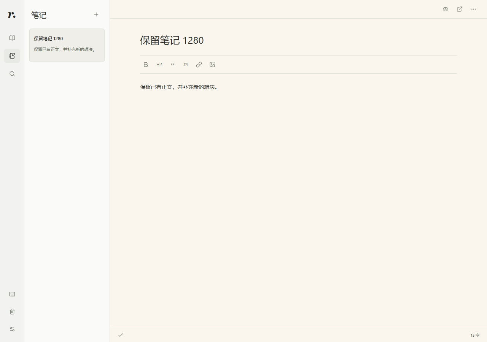

# Reader

以书籍与笔记为中心的个人阅读、学习和记录工作台。

[](https://github.com/Quiyyy/reader-plugin/actions/workflows/ci.yml)
[](LICENSE)

[快速开始](#快速开始) · [安装指南](docs/INSTALL.md) · [文档](docs/README.md) · [更新记录](CHANGELOG.md) · [参与贡献](CONTRIBUTING.md)

Reader 支持 TXT、EPUB、PDF 和在线阅读。你可以从原文划选、批注、记笔记，在浮窗里与 Codex 连续讨论，再把思考保存成能回到出处的记录。

> 当前源码为 **0.2.13**。已分发平台包以 manifest 和来源提交为准。版本范围见 [更新记录](CHANGELOG.md)。



*正式界面截图，使用项目原创测试材料。*

## 功能

- **阅读**：TXT 中文重排、结构化 EPUB、PDF 页面、目录、书签和进度恢复。
- **记录**：划选高亮、批注、图表截图、独立 Markdown 笔记，以及准确的来源回跳。
- **整理**：同层封面网格、文件夹与批量移动、最近访问排序、统一搜索、回收站、修改撤销和带附件导出。
- **讨论**：可选模型、可拖动与收起的 Codex 多轮浮窗；可辅助当前笔记编写、插图与标注，操作工具只在插件内部对话按需注入。
- **自定义**：强调色、明暗、纸色和阅读样式；响应式布局与键盘操作。

## 快速开始

准备 Node.js 24 和 npm。支持的 Node 版本为 22.13+（22 系列）、24 或 26+；不支持 23、25 系列。

获取**当前分支**的源码，在仓库根目录执行：

```sh
npm ci
npm run build
node scripts/preview-workspace.mjs --port 4187
```

打开 [http://127.0.0.1:4187](http://127.0.0.1:4187)。预览包含原创书籍和笔记，使用独立数据目录；Ctrl+C 停止服务。重用预览数据、自定义端口和插件接入见 [开发指南](docs/DEVELOPMENT.md)。

希望安装已分发版本？参阅 [安装指南](docs/INSTALL.md)，按系统选择 marketplace 平台包，或使用维护者提供的运行包。源码 ZIP 需要先安装依赖并构建。

### 阅读与记录

1. 导入一本书，或从添加菜单进入在线找书。
2. 划选文字，选择高亮、批注、记笔记或向 Codex 提问；PDF 可框选图表。
3. 在笔记里写下自己的理解，通过来源链接回看原文。

普通阅读和笔记不需要模型。阅读浮窗需要安装并登录官方 Codex CLI；程序不在 PATH 时，可用 `READER_CODEX_PATH` 指定可执行文件或官方 `codex.js` 的绝对路径。具体连接方式见 [使用指南](docs/USAGE.md)。

## 数据与权限

书籍、笔记、图片和阅读记录由本地 Reader 服务保存。支持 `READER_DATA_DIR` 自定义书库位置，默认目录如下：

| 系统 | 默认书库 |
| --- | --- |
| Windows | `%LOCALAPPDATA%/Reader` |
| macOS | `~/Library/Application Support/Reader` |
| Linux | `${XDG_DATA_HOME:-~/.local/share}/reader-plugin` |

主动向 Codex 提问时，选区、图片和问题会发送给所选模型服务。阅读对话默认可按需读取当前书籍，不会因此获得其他书籍的正文权限。在线找书会访问用户启用的书源。数据流、备份和来源保留规则见 [使用指南](docs/USAGE.md#数据与备份)。

Reader 工具默认仅插件可用，普通 Codex 对话不加载它们。Space 是可选的原生内容交接入口，笔记以 Reader 为准，没有自动双向同步。

## 当前限制

- TXT／EPUB 上限 32 MiB；PDF 上限 64 MiB、10000 页。扫描 PDF 可以阅读和截图，尚无 OCR。
- PDF 搜索覆盖已索引页；在线正文搜索覆盖本地缓存，不为搜索下载整本书。
- 不支持 MOBI/AZW3、CBZ、DRM 移除或跨设备同步；EPUB 排版范围见 [格式说明](docs/EPUB_CANDIDATE.md)。
- 原生文件入口、下载、消息交接取决于宿主能力。模拟 AppBridge 和浏览器测试通过，不等于所有 Codex 界面入口均已验收。

## 开发与贡献

```sh
npm run check
npx playwright install chromium
npm run test:e2e
```

项目使用 React、TypeScript、Node.js、MCP Apps 和 PDF.js。开发命令、目录结构、隔离测试与分发流程见 [开发指南](docs/DEVELOPMENT.md) 和 [架构说明](docs/ARCHITECTURE.md)。

欢迎通过 [Issues](https://github.com/Quiyyy/reader-plugin/issues) 反馈问题、提出建议，或提交 Pull Request。开始前请阅读 [贡献指南](CONTRIBUTING.md)；安全问题请按 [安全政策](SECURITY.md) 处理。

## 许可证

Reader 使用 [MIT License](LICENSE)。第三方代码和依赖保留各自许可证，见 [第三方声明](THIRD_PARTY_NOTICES.md)。
