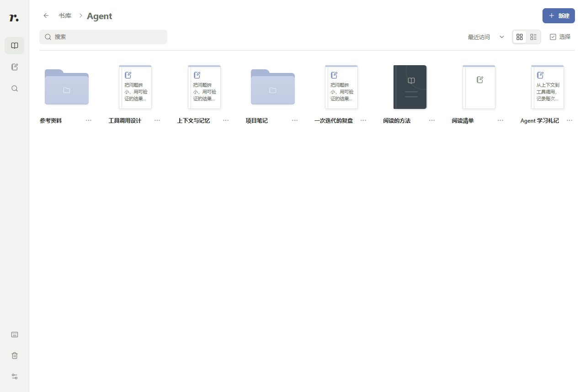

# Reader

在本地整理书籍与笔记，阅读、批注，并与 Codex 讨论原文。

[](https://github.com/Quiyyy/reader-plugin/actions/workflows/ci.yml?query=branch%3Amain)
[](LICENSE)

[安装](#安装) · [本地体验](#本地体验) · [使用指南](docs/USAGE.md) · [文档](docs/README.md) · [更新记录](CHANGELOG.md) · [贡献](CONTRIBUTING.md)

Reader 是面向 MCP Apps 宿主的阅读插件，也提供独立浏览器预览。支持 TXT、EPUB、PDF 和在线书源；书籍、笔记和文件夹放在同一书库中，摘录与笔记保留可回到原文的出处。

当前源码版本为 **0.3.2**，新增可配置的 Google Drive 多电脑同步，保留离线修改与冲突版本。首次使用需要个人 OAuth 配置；真实账号联调尚待完成。详见 [版本说明](docs/RELEASE_0.3.0.md) 和 [同步指南](docs/GOOGLE_DRIVE_SYNC.md)。平台包由 CI 分发，实际安装版本以包内 manifest 和来源提交为准。



*0.2.14 生产 UI 的隔离浏览器测试截图，使用项目原创样本；图片来源见 [截图说明](docs/images/README.md)。*

## 主要功能

| 功能 | 支持内容 |
| --- | --- |
| 整理书库 | 书籍、笔记与文件夹混合展示；网格／列表切换、最近访问排序、拖拽与批量移动、回收站和撤销 |
| 阅读原文 | TXT 中文重排、结构化 EPUB、PDF 页面、在线阅读，以及目录、书签和进度恢复 |
| 摘录与批注 | 划选高亮、PDF 区域截图、点击高亮编辑批注；侧边／底部面板保留原文上下文，保护未保存草稿 |
| 检索内容 | 书库与笔记全文搜索、范围筛选、关键词高亮、匹配位置跳转和连续查找 |
| 快速笔记 | 所见即所得／Markdown 源码双模式、选区格式与评论、常驻 AI 对话、自定义 Note Bot 与 `@` 指派 |
| 多电脑同步 | 可选 Google Drive 加密书库、离线冲突保留、原书按需下载及设备阅读位置 |
| 保存与分享 | 自动保存、图片、来源回跳、评论，以及包含附件的 Markdown 导出 |
| 与 Codex 讨论 | 可选模型的多轮对话浮窗、引用原文提问、辅助当前笔记编写与截图标注 |

界面支持明暗主题、阅读纸色、字体设置、键盘操作和窄屏布局。普通阅读与笔记不需要模型；Codex 对话需要另行配置，见 [使用指南](docs/USAGE.md#与-codex-讨论)。

## 安装

| 方式 | 适用场景 | 入口 |
| --- | --- | --- |
| 平台插件包 | 在宿主中使用 Reader；Windows／Linux 包自带 Node，无需本地编译 | [平台与安装步骤](docs/MARKETPLACE.md) |
| 免编译运行包 | 使用维护者提供的 `reader-<版本>-runtime.zip`；需要系统 Node | [运行包安装指南](docs/INSTALL.md) |
| 源码 | 本地体验、开发或构建指定提交 | [下方快速开始](#本地体验) |

按系统和架构选择一个平台包。macOS 平台包目前未开放常规安装，具体限制见 [平台说明](docs/MARKETPLACE.md#安装入口和当前限制)。GitHub 的源码 ZIP 不包含已构建的运行包。

已安装的 Windows 本地插件按 [本地更新方案](docs/LOCAL_UPDATES.md) 更新；保留原书库路径，通过桌面宿主的安装／更新入口刷新连接。

## 本地体验

准备 Git、Node.js 24 和 npm。兼容范围以 [package.json](package.json) 的 `engines` 为准：22.13+（22 系列）、24 或 26+。

获取 `main` 源码并启动隔离预览：

```sh
git clone --branch main https://github.com/Quiyyy/reader-plugin.git
cd reader-plugin
npm ci
npm run build
node scripts/preview-workspace.mjs --port 4187
```

打开 [http://127.0.0.1:4187](http://127.0.0.1:4187)。每次启动都会创建包含原创书籍和笔记的独立数据目录，不使用个人书库；按 Ctrl+C 停止。重用预览数据、自定义端口和插件接入见 [开发指南](docs/DEVELOPMENT.md)。

### 阅读与记录

1. 从“新建”导入书籍、创建笔记或文件夹；也可从“找书”进入在线阅读。
2. 拖拽条目到文件夹进行整理，或使用“选择 → 移动”批量归档。
3. 阅读时划选文字进行高亮、批注或提问，在笔记中记录自己的理解并通过来源回看原文。

使用对话功能前，需要安装并登录官方 Codex CLI。程序不在 PATH 时，可用 `READER_CODEX_PATH` 指定其绝对路径；配置方式见 [使用指南](docs/USAGE.md#与-codex-讨论)。

## 数据与隐私

书籍、笔记、图片和阅读记录由本地 Reader 服务保存。支持 `READER_DATA_DIR` 自定义书库位置，默认目录如下：

| 系统 | 默认书库 |
| --- | --- |
| Windows | `%LOCALAPPDATA%/Reader` |
| macOS | `~/Library/Application Support/Reader` |
| Linux | `${XDG_DATA_HOME:-~/.local/share}/reader-plugin` |

主动向 Codex 提问时，选区、图片和问题会发送给所选模型服务。阅读对话默认可按需读取当前书籍，不会因此获得其他书籍的正文权限。在线找书会访问用户启用的书源。数据流、备份和来源保留规则见 [使用指南](docs/USAGE.md#数据与备份)。

启用 Google Drive 同步后，所选内容会加密上传到 Reader 专属应用空间。凭据与密钥保存在本机安全存储；同步历史暂不自动清理。范围、配置与限制见 [同步指南](docs/GOOGLE_DRIVE_SYNC.md)。

Reader 工具默认仅插件可用，普通 Codex 对话不加载它们。Space 是可选的内容交接入口，笔记以 Reader 为准，没有自动双向同步。备份时请保存整个书库目录。

## 当前限制

- TXT／EPUB 上限 32 MiB；PDF 上限 64 MiB、10000 页。扫描 PDF 可以阅读和截图，尚无 OCR。
- EPUB 阅读器内查找限定当前章节；PDF 搜索覆盖已索引页；在线正文搜索覆盖本地缓存，不为搜索下载整本书。
- 不支持 MOBI/AZW3、CBZ、DRM 移除或多人实时协作；EPUB 排版范围见 [格式说明](docs/EPUB_CANDIDATE.md)。
- 原生文件入口、下载和消息交接取决于宿主能力，浏览器预览不包含全部宿主交互。

## 开发

安装依赖后执行：

```sh
npm run check
npx playwright install chromium
npm run test:e2e
```

项目使用 React、TypeScript、Node.js、MCP Apps 和 PDF.js。开发命令、目录结构、隔离测试与分发流程见 [开发指南](docs/DEVELOPMENT.md) 和 [架构说明](docs/ARCHITECTURE.md)。

## 文档与贡献

- [使用指南](docs/USAGE.md)：阅读、批注、搜索、笔记、对话和备份。
- [文档索引](docs/README.md)：安装、开发、格式范围与设计记录。
- [更新记录](CHANGELOG.md)：各源码版本的功能与修复。
- [贡献指南](CONTRIBUTING.md)：开发约定、测试要求和提交方式。

问题或建议请提交到 [Issues](https://github.com/Quiyyy/reader-plugin/issues)。安全问题请按 [安全政策](SECURITY.md) 报告。

## 许可证

Reader 使用 [MIT License](LICENSE)。第三方代码和依赖保留各自许可证，见 [第三方声明](THIRD_PARTY_NOTICES.md)。
