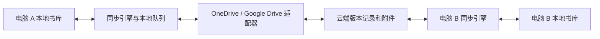

# Reader 多电脑云同步调研

调研日期：2026-10-30。代码基线：Reader 0.2.18，`371818e00396e07ee63bf12f8a187561d7baf6ab`。

目标场景已确认：同一用户在多台电脑之间同步，允许离线编辑。本文件是架构建议和公开文档调研；尚未接入云账号、上传书库或进行真实网盘 API 验收。

## 建议

采用本地优先、按独立条目同步的架构，先做一个网盘适配器。没有现成网盘偏好时，结合目前主要使用 Windows 的情况，优先验证 OneDrive；已有 Google Drive 使用习惯时可以调整顺序。同步引擎应独立于网盘供应商。

本地保存立即完成，后台传输修改；断网仍可阅读和编辑。云端作为文件存储，不承担正文冲突合并。首版面向单用户多设备最终一致；多人同时编辑需要另行设计。

成熟参考是 Joplin：其同步引擎处理本地条目、下载、上传和删除，网盘驱动提供文件读写与列举能力。[Joplin 同步设计](https://joplinapp.org/help/dev/spec/sync/)

## 现有存储对同步的影响

| 现有实现 | 同步设计需要处理的问题 |
| --- | --- |
| `study-v1/workspace.json` 集中保存笔记、文件夹、批注、引用和设置 | 两台电脑分别修改不同笔记，也会改同一个物理文件；直接同步这个文件会把独立修改变成整库冲突。 |
| 实体 `revision`、本地文件锁和原子替换 | 可以保护本机并发写入，但两台离线电脑可能产生相同 revision；不能把它当作全局版本号。 |
| 书籍和图片使用内容哈希标识 | 适合去重、校验与按需下载；同步位置还需绑定原书哈希、定位格式版本。 |
| 阅读进度、最近访问、Note Bots、对话分散保存 | 需要明确同步边界，不能只复制 `workspace.json`。 |
| 对话含 `threadId`、进程归属和运行状态 | 这些属于本机执行上下文，不能作为跨设备可恢复会话直接搬运。 |

依据：[工作台存储](../src/server/workspace-store.ts)、[原子写入和锁](../src/server/store.ts)、[Note Bots](../src/server/note-bots.ts)、[对话服务](../src/server/chat-service.ts)、[架构说明](ARCHITECTURE.md)。

**不建议将正在运行的 `READER_DATA_DIR` 直接放入 OneDrive／Google Drive 的桌面同步目录。** 文件复制不提供 Reader 所需的跨文件一致性、笔记合并或跨设备锁。可以同步关闭／一致性快照后的备份包，但那属于备份与恢复，不是离线双向编辑。

第一版可以继续使用现有本地 JSON 存储，把它作为本机视图，向同步层输出实体变化；不必把迁移数据库作为前置条件。不过内容修改与待同步记录必须能一起持久化，或通过可恢复日志保证崩溃后补发。

## 供应商与接入方式

| 方案 | 已核实能力 | 对 Reader 的判断 |
| --- | --- | --- |
| OneDrive API | Microsoft Graph 提供应用目录及 `Files.ReadWrite.AppFolder`，官方说明支持个人和工作／学校 OneDrive；目录内容由用户控制。 | 优先原型。只访问 Reader 应用目录，先验证个人账户，再验证需要支持的企业租户。 |
| Google Drive API | `appDataFolder` 是应用专属隐藏空间，使用非敏感范围 `drive.appdata`；`drive.file` 可用于应用创建或用户授权的可见文件。 | 同等可行。内部同步数据适合隐藏空间；需要在 Drive 中看到和导出书籍时，可采用应用创建的可见目录及 `drive.file`。 |
| WebDAV／Nextcloud | 标准文件操作；Nextcloud 提供 ETag 与分块上传接口。 | 适合已有私有云的用户，作为后续适配器。不同 WebDAV 服务的条件请求、限流和上传行为需分别验收。 |
| S3／对象存储 | AWS S3 支持 `If-Match`、`If-None-Match` 条件写入。 | 适合技术用户或自有服务；桶、权限、凭据与费用配置增加普通用户的使用成本。S3 兼容服务需单独验证能力。 |
| 独立交换目录＋网盘客户端／rclone | 可把文件传输交给现成客户端。 | 可用于个人备份或协议原型。交换目录必须与活动书库分离，仍需 Reader 的版本、冲突与完整性协议。 |

来源：[OneDrive App Folder](https://learn.microsoft.com/en-us/graph/onedrive-sharepoint-appfolder)、[Google 应用数据](https://developers.google.com/workspace/drive/api/guides/appdata)、[Drive 授权范围](https://developers.google.com/workspace/drive/api/guides/api-specific-auth)、[Nextcloud WebDAV](https://docs.nextcloud.com/server/stable/developer_manual/client_apis/WebDAV/basic.html)、[S3 条件写入](https://docs.aws.amazon.com/AmazonS3/latest/userguide/conditional-writes.html)。

Google 隐藏应用空间不能共享、移到普通 Drive 空间或使用 Drive 回收站；因此 Reader 需要自己管理逻辑删除、保留版本与导出。OneDrive 应用目录中的文件也可能被用户或其他获准应用修改、删除，读取时仍需校验。两者的真实网络可达性和账户限制都需在目标设备实测，不能仅凭操作系统选择。

rclone 的 `sync` 会让目标与源一致，并可能删除目标独有文件，不适合对两份各有离线修改的活动书库轮流执行。若用于备份，应传输独立、带版本的快照，保留恢复记录。[rclone sync 说明](https://rclone.org/commands/rclone_sync/)

## 增量发现与上传

Google Drive 可以保存 `startPageToken`，通过 `changes.list` 获取后续变化；该接口支持 `spaces=appDataFolder` 和相应授权范围。大附件可使用可恢复上传。[变化订阅](https://developers.google.com/workspace/drive/api/guides/manage-changes)、[changes.list](https://developers.google.com/workspace/drive/api/reference/rest/v3/changes/list)、[可恢复上传](https://developers.google.com/workspace/drive/api/guides/manage-uploads)

OneDrive 有 `deltaLink` 和可恢复上传，上传会话支持 ETag 条件检查。但 `delta` 参考页的权限表列的是 `Files.Read` 等范围，不能据此承诺仅授予 AppFolder 权限就能使用所有增量接口。原型应验证目标账户和目录路径；若不支持，先列举应用目录下的小型设备索引，避免为了轮询扩大到全盘权限。[OneDrive delta](https://learn.microsoft.com/en-us/graph/api/driveitem-delta?view=graph-rest-1.0)、[上传会话](https://learn.microsoft.com/en-us/graph/api/driveitem-createuploadsession?view=graph-rest-1.0)

这些接口报告文件变化，不替代 Reader 的版本历史。OneDrive 的 delta 返回条目的最新状态，并非逐次编辑日志。首版不依赖供应商提供跨文件事务，也不假设两家的条件写入语义完全相同。

## 建议的同步协议

1. 为每个同步书库分配 `vaultId`，每台电脑分配独立 `deviceId`。设备标识、授权凭据和下载状态不随云数据复制。
2. 笔记、文件夹、批注、Bot 配置分别生成版本记录，包含实体 ID、设备序号、父版本 ID、格式版本和内容校验值。本地 revision 继续用于 UI 冲突保护，时间戳用于展示，不单独决定正文胜负。
3. 优先采用不可变的版本记录与附件，每台设备只发布自己的最新提交索引，避免所有设备覆盖同一个总清单。记录须能幂等重传；Google Drive 不能只靠文件名识别唯一对象，需要保存对象 ID 并校验内容。
4. 先上传依赖的图片／书籍与版本数据，再发布完成标记。下载不完整的提交先暂存，依赖齐全且校验通过后，才在本地事务中应用。
5. 删除使用显式删除记录。云目录意外变空、认证失败、缺少附件都不能解释成“删除全部本地数据”；旧设备未确认删除前，保留防止旧数据复活所需的记录。
6. 同一台电脑可能运行多个 Reader 后端，需要本机同步任务互斥；网络传输期间不长期占用笔记写锁。同步引起的修改也必须经过本地 revision 和草稿保护。

实现可放在 `src/server/sync/`，拆分协调器、持久队列、版本解析、冲突处理和 Provider 驱动。云端网络与授权在后端处理，沿用现有 UI RPC，不要求网页放开云盘直连权限。

## 冲突规则

| 情况 | 首版建议行为 |
| --- | --- |
| 两台电脑修改不同笔记 | 自动合并独立条目。 |
| 同一笔记从同一个版本分叉编辑 | 保留双方版本，显示差异；用户选择或合并后形成新版本。AI 可以提供合并建议。 |
| 一台删除，另一台继续编辑 | 保留编辑分支并提示冲突，不能直接删除它。 |
| 文件夹同时移动／改名 | 验证父子引用、层级和循环；无法安全合并时保留冲突，不生成孤立笔记。 |
| 阅读位置不同 | 保留各设备位置，提供继续阅读选择；不能取“最靠后的页码”，因为用户可能主动回读。 |
| 云端更新到达时本地有未保存草稿 | 保留当前草稿，沿用现有版本冲突界面。 |

## 首批同步范围

| 数据 | 建议 |
| --- | --- |
| 笔记正文、评论、文件夹、批注、引用 | 默认同步。图片与引用依赖使用内容校验，缺失时显示待下载状态。 |
| 阅读位置、书签、书目元数据 | 默认同步，并保留设备来源及原书身份。 |
| Note Bot 名称、职责、默认选择 | 默认同步；模型可用性由各电脑的本地 Codex 配置决定。 |
| 原始 TXT／EPUB／PDF、笔记图片 | 允许同步，另一台电脑按需下载；提供提前下载选项。原书未到位时仍能查看已有笔记和摘录。 |
| 外观和快捷键 | 可选同步，允许设备自己的设置。 |
| AI 对话记录 | 单独选择，默认关闭。若支持，只同步可阅读记录，不复制正在执行的任务或本机 Codex thread ID。 |
| 解析／搜索缓存、锁、PID、临时文件、安装目录 | 留在本机，可重建的数据不上传。 |
| OAuth 凭据、Codex 登录数据、PDF 密码 | 留在本机；不得进入同步包。 |

同步状态集中放在“设置 → 同步”：连接账户、同步范围、最近同步、待处理冲突、暂停和重试。保存后合并短时间内的修改再上传，启动／恢复前台时拉取；前台运行中进行低频增量检查。首版在 Reader 运行时同步，关闭宿主后的常驻同步另行设计。

## 授权、加密与恢复

两家都采用桌面应用授权流程，通过系统浏览器完成登录，使用 PKCE 和本地回调，并把刷新凭据存入操作系统的安全存储。开发者需要注册 OAuth 应用；非敏感范围仍有基本配置和验证要求，不能把它理解为免审核。不得把可分发客户端中的静态 secret 当成保密凭据。[Google 桌面授权](https://developers.google.com/identity/protocols/oauth2/native-app)、[Microsoft 授权码与 PKCE](https://learn.microsoft.com/en-us/entra/identity-platform/v2-oauth2-auth-code-flow)、[Google scope 验证要求](https://developers.google.com/workspace/drive/api/guides/api-specific-auth)

建议在同步格式设计阶段纳入端到端加密和恢复密钥；网盘登录与书库解密是两个环节。凭据与解密密钥不以明文写入云端。启用加密后，用户必须能够在第二台电脑恢复密钥，再下载解密；无法解密时保留本地原数据。Joplin 的密钥分发与多设备处理可作为参考。[Joplin 加密设计](https://joplinapp.org/help/dev/spec/e2ee/)

不预设已连接到宿主的 Drive 插件会把后台长期授权交给 Reader。原型默认由 Reader 独立授权；只有宿主明确提供适用的代理能力时，再评估复用方式。

云同步之外仍保留独立版本备份。取消账户连接保留本地内容；恢复备份先生成新副本并比较，不直接覆盖当前书库。

## 下一步验证顺序

1. **协议原型**：两个隔离本地书库及文件／内存驱动，验证离线分叉、独立条目合并、删除与编辑冲突、崩溃续传、重复提交和旧客户端兼容。
2. **OneDrive 小范围接入**：使用原创测试数据，验证最小权限、应用目录 CRUD、增量接口或索引轮询、授权续期、附件恢复上传、取消授权与配额不足。需要覆盖的账户类型分别记录结果。
3. **Reader 集成**：接入本地修改队列和统一设置，验证同机多个 MCP 进程、正在编辑的草稿及 AI 任务不会被远端修改覆盖。
4. **恢复与故障检查**：断网、时钟偏差、上传中断、云端文件被移除、目录被清空、损坏文件、密钥恢复和设备退役。
5. **Google Drive 适配**：复用相同协议和测试，验证隐藏空间与可见目录的取舍。之后再按实际需求增加 WebDAV／对象存储。

本轮没有接入或测试真实账户，因此供应商权限组合、限流、网络表现和授权发布流程仍是原型验收项。初步推荐基于公开接口与当前 Reader 的结构，不代表云同步已经可用。
