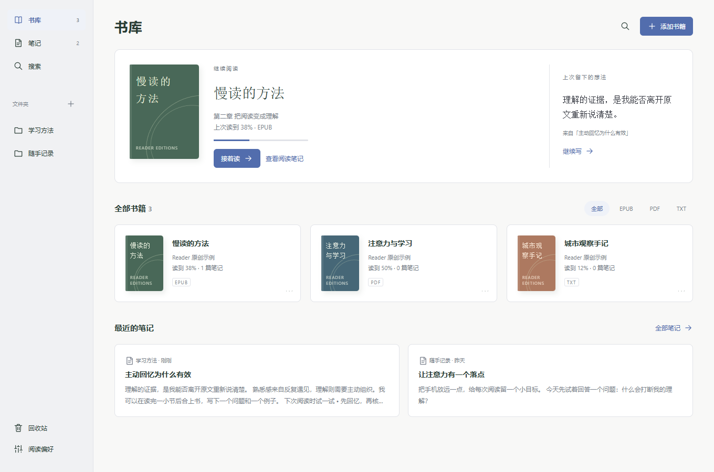
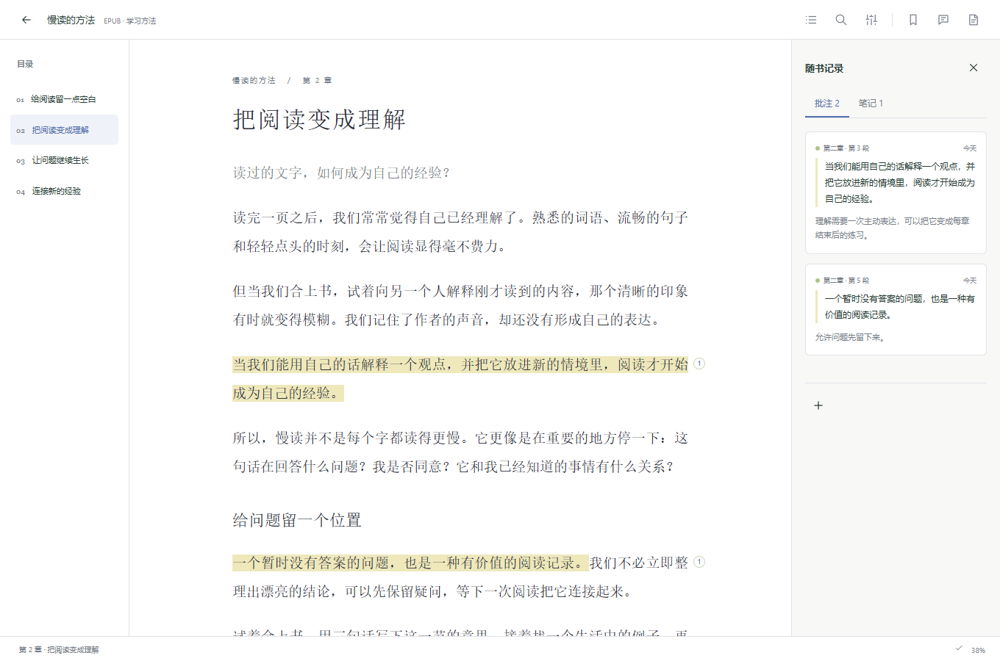
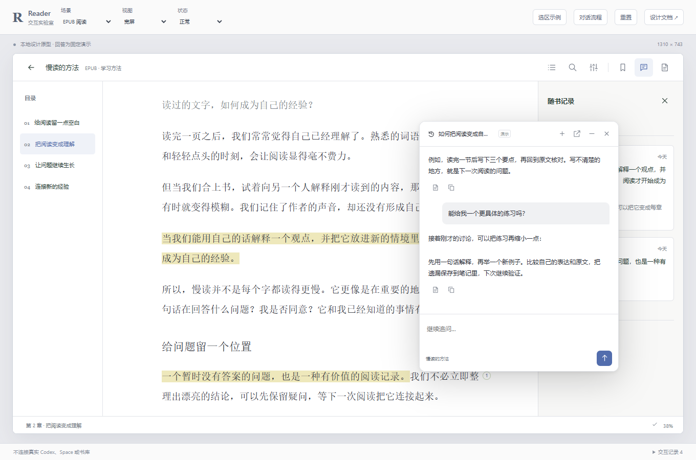
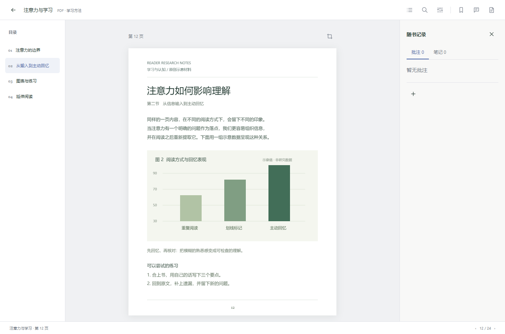
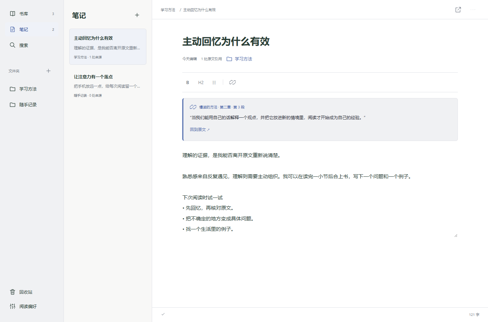
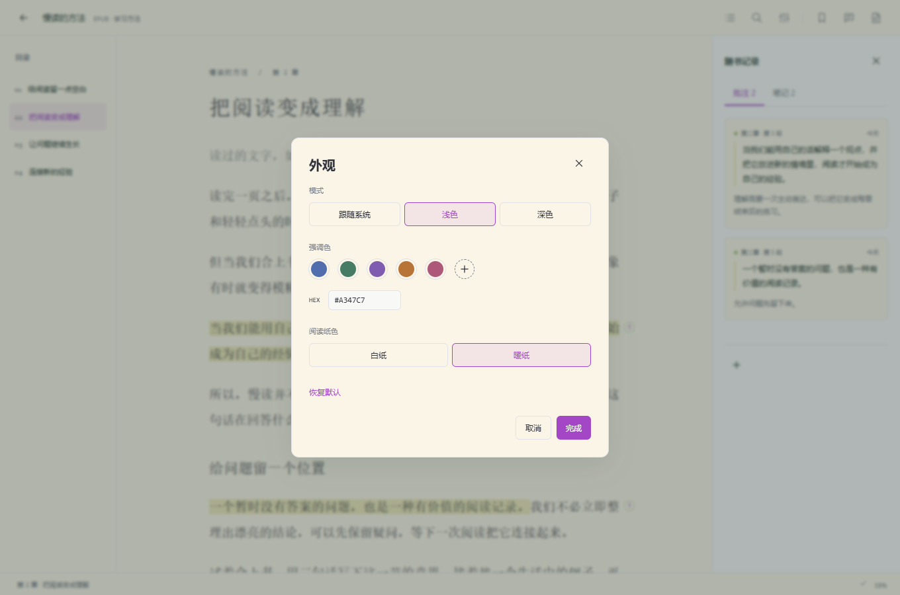
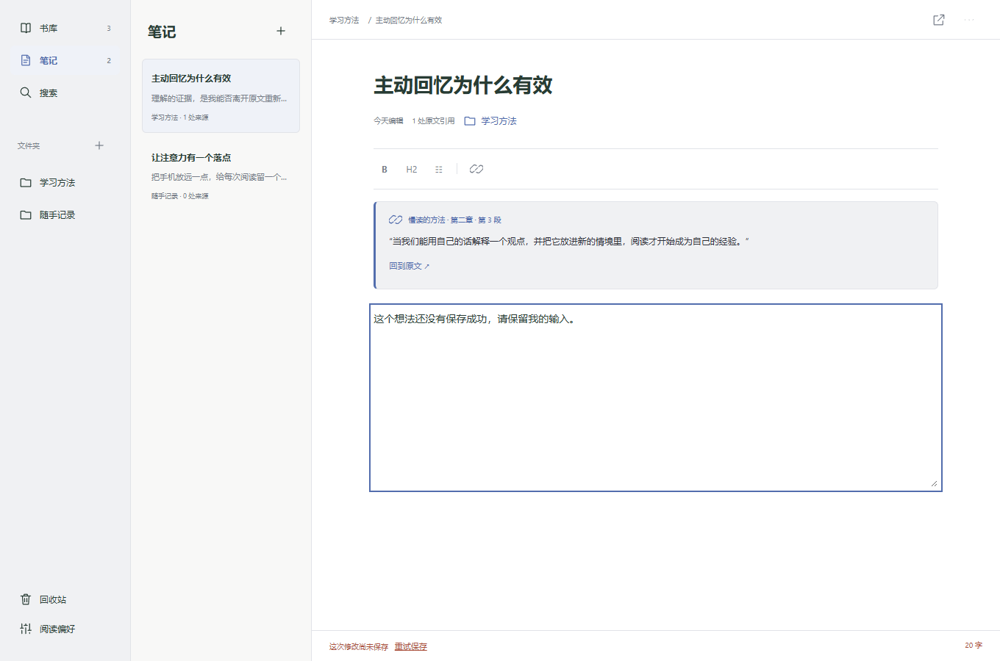

# Reader 阅读与笔记工作台产品设计

设计草案 · 2026 年 10 月 12 日

Reader 将书籍、原文批注和独立笔记组织在同一个阅读空间里。用户可以安静地读书，也可以选中一段文字或一张图表，与 Codex 讨论，再把有价值的内容保存成可回到原文的笔记。核心笔记由 Reader 保存；Space 是按需整理成果的目的地。

首个版本的体验目标是：**从原文开始的一次思考，可以被记下来、重新找到，并准确回到出处。**

[打开交互实验室](lab.html) · [直接查看阅读界面](prototype.html?view=reader) · [验证与调试说明](README.md)

## 产品范围与设计原则

本设计面向个人阅读和学习，包括阅读 EPUB 与 TXT、研读 PDF、记录随手想法、整理跨书主题，以及请 Codex 帮助理解和修改内容。已有在线找书能力继续保留，入口位于书库的添加菜单；书源配置保留为次级管理，不占据主要导航。

Reader 首期独立完成笔记编辑、组织、搜索、保存和导出。与 Codex 的交互使用 Reader 内可收起的阅读对话浮窗，计划接入官方 Codex 持续会话能力，同时保留交给原生对话的入口。书籍和笔记操作都可以由用户或 Codex 完成。Space 联动以用户主动发起的整理与链接为范围，不承诺内嵌原生编辑器或持续双向同步。

- 阅读区优先获得空间。新增能力按需出现，浮窗覆盖在阅读区上方，不挤出常驻聊天栏。
- 用户决定配色。明暗模式、强调色与阅读纸色可配置；截图中的颜色只是预设，不是固定品牌色。
- 通过位置、图形和状态表达功能。移除装饰性标题、重复说明和常驻教程，图标名称在悬停或键盘聚焦时出现。
- 选区是操作起点。高亮、批注、提问和摘录共享一次选择，不要求先切换工具模式。
- 先保留原文，再表达自己的理解。笔记中的引用与正文有清楚的视觉区别。
- 内容只保存一份权威版本。文件夹移动、跨主题引用和整理到 Space 都有明确语义。
- 保存、发送和完成分别反馈。已加入对话不代表已经生成回答，已有草稿不代表已经保存成功。
- 书籍与笔记能独立使用。普通编辑和阅读不等待 Codex 回复。

## 用户会反复完成的事情

| 情境 | 用户目标 | 成功体验 |
| --- | --- | --- |
| 晚上接着读书 | 快速回到上次的位置 | 打开 Reader 后直接看到继续阅读，保留视图和滚动位置 |
| 遇到不理解的一段 | 带着准确上下文提问 | 选区加入阅读浮窗，用户可连续追问，收起后继续读书 |
| 阅读论文图表 | 讨论图像而不丢失出处 | 框选图表后携带实际图片、书名与页码；点击引用回到该区域 |
| 想到一个观点 | 先记下来，再整理 | 可直接新建无来源笔记，也能把选区加入已有笔记 |
| 回顾一个主题 | 找到相关书籍、批注和笔记 | 统一搜索并分组展示命中内容，每条结果保留来源 |
| 请 Codex 整理资料 | 看清修改结果 | 显示修改对象与结果，支持查看原文、重试和撤销最近修改 |

## 内容对象与组织方式

**书籍**保存原始内容、目录和阅读位置。首次导入的标题可修改，相同文件再次导入回到已有书籍。书名相同的不同文件可以并存；新版本书籍不会静默继承旧版引用。

**批注**直接附着在书中，包括文字高亮、页边评论和 PDF 区域摘录。高亮不强制填写评论；添加评论时保留原始选区。批注面板按原文顺序排列，可按颜色和是否有评论筛选。

**笔记**是可独立存在的文档，包含自己的文字、标题、列表、图片和来源卡片。一本书可以关联多篇笔记，一篇笔记可以引用多本书。删除笔记中的引用卡片不删除书内批注；移除批注也不抹去笔记里已经保存的引文。

**文件夹**负责书籍和笔记的日常归档，每个条目有一个归属位置。第一版允许最多三层嵌套，避免过深目录。标签支持跨文件夹检索；“添加引用”不会复制原文件。把一个文件夹移到自己的子级会被阻止并说明原因。

**引用**连接笔记和书籍中的具体位置。卡片显示书名、章节或页码、原文摘录，区域引用另含缩略图。书名和文件夹变动后引用继续有效；来源不可用时仍保留摘录，并显示恢复入口。

## 信息架构与入口

一级导航为 **书库、笔记、搜索**，下方为文件夹和回收站。阅读页以返回入口连接书库，不重复绘制宿主已经提供的应用品牌栏。阅读历史作为书库中的“继续阅读”，不增加单独首页。

| 页面 | 主操作 | 次级操作 | 离开时保留 |
| --- | --- | --- | --- |
| 书库 | 继续阅读、打开书籍、导入 | 新建文件夹、移动、元数据、在线找书 | 文件夹、筛选、排序、滚动与焦点 |
| 阅读 | 阅读、划选、批注、提问 | 目录、搜索、外观、书签、关联笔记 | 位置、打开的面板、选定笔记 |
| 笔记 | 编辑、插入引用、回看来源 | 归档、标签、导出、整理到 Space | 编辑位置、草稿、列表筛选 |
| 搜索 | 输入关键词、打开结果 | 书籍／批注／笔记筛选 | 关键词、结果、返回位置 |
| 回收站 | 恢复条目 | 查看关联影响、永久删除 | 当前筛选 |

全局搜索覆盖书名、可索引的正文、批注和笔记。阅读工具栏的搜索默认只查当前书。在线书籍只检索已经缓存的内容，并显示范围；扫描 PDF 未识别的页面只参与标题和手工批注搜索。

## 书库与当前界面的优化

当前界面保持紧凑正文工具栏、纸色与深色外观、阅读位置保存、书签、目录以及可恢复回收站。新书库把继续阅读置于顶部，书籍条目同时显示阅读进度和关联笔记数量。第二行采用明确的书籍列表，不用大面积数据仪表盘占据空间。

当前正文留白与字体层次适合作为新设计基线。需要改进的是新增学习动作的可发现性、书签与批注的区分，以及从内容回到独立笔记的路径。

“添加”菜单集中提供导入书籍、在线找书和新建文件夹；笔记页另有新建笔记。首次进入时只呈现“导入第一本书”和“先写一篇笔记”。导入后显示实际结果：成功、重复、待输入密码、格式不支持或部分失败；批量导入允许保留成功项并单独重试失败项。

## 阅读与学习工作区

阅读顶部保留返回、书名、目录、查找、外观和学习面板入口。书签表示以后要回来的位置，高亮表示用户选中的内容，两者使用不同名称与图形。底部只显示章节或页码、阅读进度和保存状态。

宽屏可按需打开目录和右侧学习面板；进入阅读时恢复用户上次选择，不强制三栏。右侧面板有“批注”和“笔记”两个页签。批注显示原文与短评论；笔记页签显示与本书有关的笔记，可快速追加引用或进入完整编辑。

点击批注时，原文滚动到对应段落并短暂强调目标；正文标记与侧栏卡片同步选中。阅读过程中可以折叠面板。查看引用属于临时查看，提供“返回刚才的位置”，不立刻替换用户的长期阅读进度。

## 划选文字与向 Codex 提问

划选后出现靠近选区的紧凑图标工具条，对应**高亮、批注、问 Codex、记笔记**。鼠标悬停或键盘聚焦时显示名称；操作条不遮挡选中文字，靠近视口边缘时自动换位。键盘选择文本也可触发，Esc 关闭操作条；触摸环境保留系统选择手柄，低频操作可以通过带短标签的菜单进入。

| 操作 | 用户看到什么 | 保存或发送时机 |
| --- | --- | --- |
| 高亮 | 使用上次颜色，显示撤销 | 点击后保存，失败则保留临时标记与重试 |
| 批注 | 引文上方固定，下面输入评论 | 点击保存；取消只关闭编辑，不删除已有高亮 |
| 问 Codex | 阅读浮窗打开，输入区附上一条可展开的来源标签 | 用户发送后才请求回答；同一话题可继续追问 |
| 记笔记 | 选择新笔记或已有笔记 | 选定后插入来源卡，自己的正文保持可编辑 |

发送的默认范围是所选文字或所选图片。来源默认折叠为“书名 · 位置”标签，点开才展示摘录或图片，可移除或附附近段落；不会自动附上整本书。用户可以为当前书允许 Codex 按需读取更多内容，后续请求沿用这一范围。

## 阅读对话浮窗

浮窗属于当前阅读空间，默认不出现。用户点击“问 Codex”或对话图标时打开，可在桌面宽度下拖动，收起为小按钮；关闭后再次打开仍恢复当前讨论。它不改变正文宽度，不自动打开目录或笔记侧栏。

同一本书可以保留多个话题。划选新内容默认加入当前话题，通过输入区来源标签确认；只有点击“新话题”才创建另一段讨论。话题切换保留历史、来源和未发送草稿。翻页、切章、收起窗口不会丢弃正在等待的回复。

浮窗头部只保留话题入口、新话题、交给原生对话、收起和关闭图标。正文区域展示消息，底部是多行输入与发送图标。用户可以连续追问、停止生成、失败后重试，也可以将某条回答写成新笔记或加入已有笔记。保存时连同该条回答实际使用的原文来源一起保留。

在 320px 至 719px 宽度下，浮窗贴近底部，以可关闭的面板显示，输入区避开屏幕键盘。用户收起后立即回到原来的阅读位置；空间不足时允许展开为临时全屏对话，而不是把正文压成窄列。

Reader 管理的是独立阅读会话，不默认复制当前 Codex 主对话的全部历史、工具和权限。“交给原生对话”仅交接用户选择的内容与问题，不声称两个会话已同步。连接不可用时保留问题和来源，显示简短状态以及重试、复制入口。

产品实现计划采用官方 Codex 会话接口，真实连续问答、会话恢复、登录和 Reader 工具调用需先完成专项验证。当前交互原型以明确标注的本地演示回答呈现流程，不调用模型。

Codex 改动笔记、文件夹或批注后，Reader 显示更新结果与“撤销”；批量改动先展示目标范围。编辑中的笔记若已有更新，保留当前草稿并提供比较入口，不能用后台新内容直接覆盖输入。

## PDF 阅读与区域引用

PDF 首期包含分页浏览、缩放、目录、文本选择、页内查找、标记与区域摘录。固定页面保留原排版；多栏文章和图表允许以区域图片作为上下文。页面索引与印刷页码同时存在时，显示“第 12 页 · 书内页码 7”，引用保存精确页面位置。

“框选区域”进入一次性框选状态，光标和短提示明确改变。拖动后显示实际裁剪预览，用户选择问 Codex、添加批注或加入笔记；Esc 取消。坐标随着缩放和旋转换算，回看引用时自动定位整个区域。

无文本层的扫描件显示“此页暂不可选择文字，可框选提问”。可在后续版本增加按页识别文字；OCR 未完成或失败不阻止正常看图。加密 PDF 提示输入密码后在当前导入流程使用，DRM 文件保留明确的不可读说明。

## 笔记编辑与原文回跳

笔记工作区采用列表与编辑区，宽屏可按需打开来源面板。首期编辑支持段落、小标题、列表、任务项、引用、图片、链接与基础格式。默认以标题和正文开始，不要求先创建模板或填写标签。

新建笔记可以为空，也可以由选区开始。来源卡与自己的正文有不同背景和清楚边界；原文摘录保持可辨认，旁边可补充理解。每张来源卡都支持回到原文，当前笔记中所有引用也在“来源”列表集中展示。

从笔记进入原文后，顶部出现“返回笔记”，回去时恢复光标和滚动位置。来源被放入回收站时先显示“恢复来源”；文件损坏或版本不符时保留摘录，允许重新定位，不能跳到一个近似位置并声称匹配成功。

输入时自动保存；处理中和失败状态明确显示，保存成功后收敛为小型状态图标，悬停可查看时间与位置。失败时显示持续提示“修改尚未保存”，保留文字并提供重试和复制。用户离开时，若仍有未保存内容，提供继续等待、复制草稿或留在当前页。

Space 操作命名为“整理到 Space”，要求选择或明确新建目标 Page，并展示即将传出的内容。成功后保留页面链接、整理时间和对应笔记版本；以后修改本地笔记时显示“本地有新修改”。这是一次有结果的整理操作，不使用“已同步”字样。

## 文件夹与回收站

书籍和笔记使用相同的移动选择器，支持创建、重命名、移动文件夹以及撤销最近移动。重命名保持条目与引用不变。删除非空文件夹先解释内容的去向，默认只移除文件夹并将内容移到上一级；另一个明确选项才会把内容一并移入回收站。

移动到回收站会保留正文、笔记、批注与关系。被引用的书籍或笔记旁显示关联数量。恢复后原引用重新可用；永久删除必须在回收站里单独执行，并展示会失去哪些原文跳转或附件。

## 不同宽度下的交互

| 插件可用宽度 | 阅读布局 | 笔记布局 | 对话关系 |
| --- | --- | --- | --- |
| 1100px 及以上 | 正文居中，目录与学习面板按需展开 | 列表与编辑区，来源按需展示 | 可拖动浮窗，收起后不占正文空间 |
| 720 至 1099px | 正文加一个辅助面板；空间不足则用抽屉 | 列表收起，编辑优先 | 浮窗仍覆盖显示，不增加常驻列 |
| 320 至 719px | 正文、目录、批注或笔记一次显示一个工作区 | 列表进入编辑页，返回保留状态 | 底部浮层，必要时临时全屏 |

紧凑工具栏以常见图标为主，次要功能进入菜单。点击目标至少 36px，主要触摸目标尽量达到 44px。可见焦点、合理 Tab 顺序、抽屉关闭后的焦点恢复和非颜色唯一标识，都纳入交付标准。动画遵循减少动态效果偏好。

## 用户可配置的外观

外观入口集中管理明暗模式、强调色和阅读纸色。明暗模式提供跟随系统、浅色与深色；强调色提供少量预设和自定义颜色；阅读纸色与界面强调色分开。设置即时预览，完成后保存，取消则恢复进入前的样式；可一键恢复默认。

强调色应用于主按钮、焦点、选中状态和来源标识。正文文字、背景和禁用状态保持足够对比度，必要时使用所选颜色的可读衍生色；错误、警告和成功仍有图标与文字，不能只凭颜色判断。书籍封面和用户高亮颜色不被主题色强制改写。

外观在书库、阅读、笔记、浮窗之间保持一致，重新打开仍保留。示意图默认配色可随用户设置变化。

## 界面文字与图标规则

功能通过明确分区、固定位置、常用图标、选中状态和直接反馈表达。移除英文装饰眉题、重复的使用指南、“你可以……”式常驻说明，以及空白区域中的长篇介绍。

| 内容 | 呈现原则 |
| --- | --- |
| 一级导航、文件夹、书名和笔记标题 | 保留短标签，帮助快速定位 |
| 阅读、划选、编辑与浮窗工具栏 | 图标优先；悬停与键盘聚焦显示名称和可用快捷键 |
| 初次或空状态 | 最多一个短标题，加直接可执行的操作 |
| 来源 | 默认书名与位置；摘录和图片按需展开 |
| 保存失败、离线、连接和权限变化 | 保留必要状态与恢复操作，不藏在悬停提示里 |
| 删除、覆盖、对外整理等有影响的操作 | 操作前简短说明对象和后果 |
| 帮助与详细说明 | 放入帮助入口或展开项，正常阅读时不显示 |

每个纯图标按钮都保留无障碍名称。悬停提示不截获点击，Esc 可关闭；触屏用户不依赖 hover 才能完成主要操作。图标存在歧义时，宁可在菜单中保留短标签，也不靠长段说明补救。

## 异常状态与用户可恢复性

| 状态 | 界面反馈 | 可继续的事情 |
| --- | --- | --- |
| 空书库 | 导入第一本书或先写笔记 | 无需配置书源即可开始 |
| 本地保存失败 | 保留输入，持续提示与重试 | 复制草稿、继续编辑 |
| 离线 | 本地内容照常可用；联网操作单独提示 | 读缓存章节、写笔记 |
| Codex 不可用 | 保留选区、问题和来源 | 复制内容、写本地批注 |
| 在线章节未缓存 | 说明该章需要联网 | 回到已缓存章节 |
| 引用失效 | 保留原文摘录，显示缺失原因 | 恢复来源或手动重新定位 |
| Codex 与用户同时修改 | 保留草稿并显示差异 | 选择合并、保留本地或采用新版本 |
| 部分批量操作失败 | 分列成功项与失败项 | 只重试失败项，不重复已完成操作 |

## 首期范围与后续扩展

首期完整流程包括书库组织、基础独立笔记、文字与区域批注、来源回跳、PDF 阅读、选区交给 Codex，以及 Codex 操作书籍和笔记的反馈。现有 TXT、EPUB、在线书籍和阅读设置继续可用。

Space 整理作为可选连接；跨书检索增强、OCR、笔记模板、复习任务、跨设备同步和多人协作放在后续阶段。产品先保留清晰的来源关系和可导出内容，为以后扩展留下基础。

## 用户验收场景

1. 导入 EPUB 或 TXT 后继续阅读，退出并重开仍回到正确位置；已有书籍和书签完整保留。
2. 划选一句话，保存高亮和评论，再从批注列表回到同一句话。
3. 从选区新建笔记，补充自己的理解；也能将另一处选区加入这篇笔记。
4. 从笔记引用进入原文，再返回笔记时仍保留编辑位置。
5. 在 PDF 中框选图表，预览实际图片，向 Codex 发送带页码的提问，再保存回答。
6. 用户与 Codex 都可以创建、移动、修改笔记；已打开界面显示结果，误操作可撤销。
7. 移动或重命名书籍后引用仍有效；来源放入回收站后，引用显示恢复入口。
8. 关闭网络后继续写本地笔记；保存失败时草稿可恢复且不会显示为已保存。
9. 在 320px、390px 与宽屏完成阅读、批注、笔记回跳，不出现水平溢出或遮住主操作。
10. 向 Space 整理后得到目标 Page 链接；没有成功回执时不显示完成。
11. 浮窗中连续追问两轮，收起、拖动、切换话题与重新打开后仍恢复对应历史和草稿，正文宽度不变。
12. 修改强调色及明暗模式后，书库、笔记与对话一致变化；刷新后保留，取消预览恢复旧值。
13. 纯图标操作可通过悬停、键盘与辅助技术辨识；错误和保存失败不依赖悬停才被发现。

## 交互原型与调试范围

交互实验室提供书库、EPUB 阅读、PDF 示意、笔记和搜索，以及宽屏、900px、390px、320px 环境。用户可在产品外观设置中切换主题与强调色。空书库、离线、保存失败、来源缺失和连接不可用可重复切换。阅读浮窗明确标注演示，发送和回复均为本地交互模拟。

原型使用原创示例内容。可执行的设计流程包括选择文字、高亮、批注、提问暂存、演示回答入笔记、引用回跳、笔记编辑保存、文件夹创建与归档、搜索和错误恢复。PDF 页面是交互示意，不宣称实现真实 PDF 解析；导入和 Space 操作只展示流程，不上传文件或访问账户。

现有生产界面继续使用仓库的原生 MCP 加模拟 AppBridge 检查，原型实验室只验证交互和布局。这两类结果都不能代替真实 Codex 的宿主验收。实验室先作为仓库内独立开发工具，稳定后再考虑提取为通用插件工具；本轮不增加生产 MCP 控制接口。

## 已确定的边界与待讨论的偏好

已确定：Reader 拥有核心笔记；Space 可选；阅读浮窗支持持续会话并保留交给原生对话的入口；主题由用户配置；常驻说明保持最少；引用可以回到原文；已有阅读功能与数据得到保留。

后续可继续讨论：文件夹与标签是否需要同等突出；笔记编辑默认简洁排版还是更强的块编辑；PDF 与 EPUB 在首期资源分配中的优先次序。这些偏好不影响先完成上述核心流程。

## 产品能力依据

- [MCP Apps 界面与模型上下文](https://developers.openai.com/plugins/build/chatgpt-ui)：选区上下文、发送消息与状态归属；目标客户端能力需要实际检查。
- [OpenAI 插件扩展](https://developers.openai.com/plugins/build/extensions)：入口、深链接与输入框引用方向。
- [Space 代理协作](https://learn.chatgpt.com/docs/space/agents)：作为用户主动整理成果的目的地。
- [插件文件接口](https://developers.openai.com/plugins/reference#file-apis)：宿主文件选择与上传能力，不等同于 Page 编辑接口。
- [Codex App Server](https://learn.chatgpt.com/docs/app-server)：自定义客户端的持续会话、回复事件与工具交互；当前仍需固定版本并完成实际验证。

Space 联动边界核查日期为 2026 年 10 月 12 日。公开资料尚未确认供外部插件直接依赖的 Space 数据后端和嵌入式编辑器；本产品的基本笔记体验不依赖这些能力。
